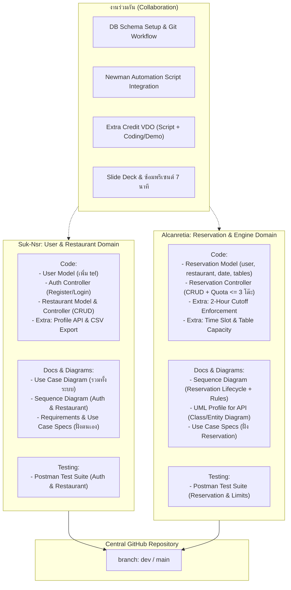

# Project Plan: Restaurant Reservation System (Project #5)
> **วิชา:** 2110503 Software Development Practice (2569)  
> **คะแนนรวม:** 35% (Term Project) + 3%* (Extra Credits)  
> **ระยะเวลานำเสนอ:** 7 นาที (Demo + Presentation) + ถามตอบ 3 นาที

---

## 1. วัตถุประสงค์และข้อกำหนดตามเกณฑ์ Syllabus

> [!IMPORTANT]
> **กฎเหล็กเรื่องการแบ่งงาน (จาก Syllabus ข้อ 17):**  
> *"นิสิตแต่ละคนควรต้องได้เขียนโค้ด และทำเอกสาร (เขียน diagram) และจะได้คะแนนสัดส่วนตามงานที่ทำ เช่น ทำเอกสารอย่างเดียว ได้ไม่เกิน 5% เป็นต้น"*  
> **แนวทางปฏิบัติ:** ทั้ง 2 คนต้องแบ่งงานแบบ **Vertical Slice** โดยต่างฝ่ายต่างเขียน Code จริง มีประวัติ Git Commit ของตัวเอง และทำทั้ง Diagram, Postman Test รวมถึงร่วมกันพรีเซนต์

### สัดส่วนคะแนนการประเมิน (35% + 3%*)
* **Project Functions (20%):** ฟังก์ชันทำงานถูกต้อง ครบถ้วนตามโจทย์ Baseline และไม่มีบั๊ก
* **Project Presentation & Demo (5%):** นำเสนอชัดเจนใน 7 นาที และเดโมการทำงานอัตโนมัติด้วย **Postman Runner / Newman**
* **Project Completeness (5%):** ความสมบูรณ์ของระบบ Error Handling, Security, และ Code Structure
* **Project Documentation (5%):** เอกสารและ Diagrams (Requirements, Use Cases, Sequence Diagram, UML Profile for API)
* **Extra Credits (3%*):** ฟีเจอร์เสริมพิเศษ พร้อมคลิปวิดีโอสอนสร้าง (**Extra Credit VDO**)

---

## 2. ข้อกำหนดระบบและเงื่อนไขทางเทคนิค (System Requirements & Constraints)

### 2.1 ข้อจำกัดทางเทคนิค (Constraints)
* **API Only:** ระบบต้องพัฒนาเป็น Web API ในรูปแบบ REST APIs
* **No Frontend:** ไม่ต้องพัฒนาส่วนติดต่อผู้ใช้ (Frontend)
* **Database:** ใช้ MongoDB Atlas ร่วมกับ Mongoose
* **Environment:** พัฒนาด้วย Node.js และ Express Framework

### 2.2 ข้อกำหนดด้านคุณภาพ (Non-Functional Requirements)
* **Security:** 
  * ระบบต้องยืนยันตัวตนผู้ใช้งานด้วย Username/Email และ Password
  * ระบบต้องรักษาความลับของธุรกรรมผู้ใช้งาน (Confidentiality) ผ่าน JWT Authentication และการจำกัดสิทธิ์ (Authorization)
* **Performance:** ระบบต้องตอบสนองคำขอ (API Response) ภายในเวลาไม่เกิน 3 วินาที
* **Usability & Testing:** ระบบต้องถูกเรียกใช้งานและทดสอบการทำงานอัตโนมัติผ่าน Postman / Newman

### 2.3 ข้อกำหนดการทำงานพื้นฐาน (Baseline Requirements)
1. The system shall allow a user to register by specifying the name, telephone number, email, and password.
2. After registration, the user becomes a registered user, and the system shall allow the user to log in to use the system by specifying the email and password. The system shall allow a registered user to log out.
3. After login, the system shall allow the registered user to reserve up to 3 tables by specifying the date and the preferred restaurant. The restaurant list is also provided to the user. A restaurant information includes the name, address, telephone number, and open-close time.
4. The system shall allow the registered user to view his/her restaurant reservation.
5. The system shall allow the registered user to edit his/her restaurant reservation.
6. The system shall allow the registered user to delete his/her restaurant reservation.
7. The system shall allow the admin to view any restaurant reservation.
8. The system shall allow the admin to edit any restaurant reservation.
9. The system shall allow the admin to delete any restaurant reservation.

### 2.4 ข้อกำหนดส่วนขยายพิเศษ (Extra Credit Requirements)
1. The system shall allow the registered user to select a specific dining time slot (within the restaurant's open hours) on the reservation date, and automatically prevent bookings if the restaurant's table capacity is fully booked for that slot.
2. The system shall allow a registered user to view and update their profile details (name and telephone number) and change their password by verifying their current password.
3. The system shall enforce a cancellation and modification cutoff, permitting a registered user to edit or delete a reservation only if there are at least 2 hours remaining before the reserved time.
4. The system shall send an automated reservation confirmation email to the registered user upon successful booking, modification, or cancellation via a third-party email service (e.g., SendGrid or Resend).
5. The system shall allow the admin to export all reservation records within a selected date range as a downloadable CSV file.
6. The system shall allow the registered user to specify the guest count (party size) and provide optional dietary requirements or special requests (e.g., food allergies, seating preferences) when creating a reservation.

---

## 3. โครงสร้างการแบ่งงานระหว่างสมาชิก (50/50 Work Division)



---

## 4. ตารางแจกแจงงานและสถานะ (Task Tracking Matrix)

> [!IMPORTANT]
> **ข้อตกลงการอัปเดตสถานะงาน (Status Update Protocol):**  
> ทุกครั้งที่มีการเริ่มทำหรือพัฒนาส่วนใดเสร็จสิ้น (รวมถึงการเขียนโค้ด, วาด Diagram, ทำ Test หรือ Merge PR) **จะต้องเข้ามาอัปเดตสถานะในตารางนี้เสมอ** เพื่อให้เพื่อนร่วมทีมและผู้ช่วย AI ทราบความคืบหน้าที่แท้จริง:
> - **Not Started:** งานที่ยังไม่ได้เริ่ม
> - **In Progress:** กำลังดำเนินการอยู่ (ระบุ Branch หรือความคืบหน้า)
> - **Done:** งานเสร็จสมบูรณ์ ผ่านการทดสอบ (Tested) และ Merge โค้ดเรียบร้อยแล้ว

### ส่วนที่ 1: Baseline Features & Core API

| หมวดหมู่ | งาน / ฟีเจอร์ | ผู้รับผิดชอบหลัก | ผลลัพธ์ / Deliverables | สถานะ |
| :--- | :--- | :---: | :--- | :---: |
| **Setup** | • Clone repo, สร้างโฟลเดอร์, วางโครงสร้างจาก VacQ<br>• ตั้งค่า `.env` และเชื่อมต่อ MongoDB Atlas | **Suk-Nsr & Alcanretia** | โครงสร้างโปรเจกต์พร้อมรัน `npm run dev` | Done |
| **User & Auth** | • Refactor `models/Users.js`: เพิ่มฟิลด์ `telephone number` พร้อม regex ตรวจสอบ<br>• ตรวจสอบ Register, Login, GetMe, Logout ให้ส่ง `tel` กลับมาด้วย | **Suk-Nsr** | Auth API รองรับเบอร์โทรสมบูรณ์ | Done |
| **Restaurant** | • สร้าง `models/Restaurant.js` (name, address, telephone, open-close time)<br>• สร้าง `controllers/restaurants.js` และ `routes/restaurants.js`<br>• รองรับ CRUD (Public ดูได้, Admin สร้าง/แก้ไข/ลบได้) | **Suk-Nsr** | Restaurant CRUD API ครบถ้วน | Done |
| **Reservation** | • สร้าง `models/Reservation.js` (apptDate/reservationDate, user, restaurant, tablesCount)<br>• สร้าง `controllers/reservations.js` และ `routes/reservations.js`<br>• User ทั่วไปดู/แก้/ลบได้เฉพาะของตนเอง<br>• Admin ดู/แก้/ลบได้ทุกการจองในระบบ | **Alcanretia** | Reservation CRUD API ครบถ้วน | Done |
| **Booking Logic** | • ตรวจสอบโควตา: Registered User จองได้สูงสุดไม่เกิน 3 โต๊ะ (หรือ 3 การจอง)<br>• ถ้าไม่ใช่ Admin แล้วพยายามจองเกิน ให้คืนค่า HTTP 400 Bad Request | **Alcanretia** | Validation Logic ใน `addReservation` | Done |

---

### ส่วนที่ 2: Extra Credits (เคลมคะแนนเต็ม 6 ข้อ)

| ฟีเจอร์ Extra Credit | ผู้รับผิดชอบหลัก | รายละเอียดฟังก์ชัน | สถานะ |
| :--- | :---: | :--- | :---: |
| **1. 2-Hour Cutoff Enforcer** | **Alcanretia** | ตรวจสอบว่าเหลือเวลาก่อนถึงเวลานัดหมาย $\ge 2$ ชั่วโมงหรือไม่ ถ้าเหลือน้อยกว่า 2 ชม. จะไม่อนุญาตให้แก้หรือยกเลิกการจอง | Done |
| **2. Time Slot & Table Capacity** | **Alcanretia** | ให้เลือกช่วงเวลา (Slot) ในช่วงเวลาเปิด-ปิด และเช็คความจุโต๊ะรวมของร้านใน Slot นั้น ไม่ให้จองเกิน | Done |
| **3. Profile & Password Management** | **Suk-Nsr** | API `PUT /auth/updatedetails` (แก้ชื่อ, เบอร์โทร) และ `PUT /auth/updatepassword` (ตรวจรหัสผ่านเดิมก่อนเปลี่ยน) | Done |
| **4. Automated Email Confirmation** | **Suk-Nsr** | ระบบส่งอีเมลแจ้งเตือนอัตโนมัติเมื่อมีการจองสำเร็จ, แก้ไข หรือยกเลิกการจองผ่าน Third-party Service (Resend / SendGrid / Nodemailer) | Done |
| **5. Admin CSV Export** | **Suk-Nsr** | API `GET /reservations/export` ให้ Admin ดึงข้อมูลการจองตามช่วงวันที่เป็นไฟล์ `.csv` | Done |
| **6. Guest Count & Special Requests** | **Alcanretia** | รองรับการระบุจำนวนแขก (`partySize`) และคำขอพิเศษ/ข้อจำกัดด้านอาหาร (`specialRequests`) บันทึกลงระบบ | Done |

---

### ส่วนที่ 3: เอกสารและ Diagrams (Documentation - 5%)

> [!NOTE]
> ตามเกณฑ์ Syllabus: *"อธิบายเฉพาะส่วนที่แก้ไปจากเดิม และไม่ต้องทำ diagram สำหรับ Extra Credits"*

| รายการเอกสาร / Diagram | ผู้รับผิดชอบหลัก | รายละเอียดงาน | สถานะ |
| :--- | :---: | :--- | :---: |
| **Requirements & Use Case Specs** | **Suk-Nsr & Alcanretia** | Suk-Nsr รับผิดชอบสเปกฝั่ง Auth & Restaurant / Alcanretia รับผิดชอบฝั่ง Reservation | Done |
| **Use Case Diagram (รวมทั้งระบบ)** | **Suk-Nsr** | วาด Diagram ภาพรวม แสดง Actor: Guest, Registered User, Admin เชื่อมกับ Use Cases ทั้งหมด | Done |
| **Sequence Diagram 1: Auth & Restaurant** | **Suk-Nsr** | แสดง Interaction การ Register (มีเบอร์โทร) และ Admin สร้าง/แก้ไขข้อมูลร้านอาหาร | Done |
| **Sequence Diagram 2: Reservation Lifecycle** | **Alcanretia** | แสดง Interaction การจองโต๊ะ (ผ่านการเช็คโควตา 3 โต๊ะ) และการแก้ไข/ยกเลิก (ผ่านการเช็ค Cutoff 2 ชม.) | Done |
| **UML Profile for API (Class/Entity Diagram)** | **Alcanretia** | แสดงโครงสร้าง Entity (User, Restaurant, Reservation), Relationships, Attributes, และ Mapping สู่ REST Endpoints | Done |

---

### ส่วนที่ 4: Testing & Automation (Newman / Postman - 5%)

| รายการทดสอบ | ผู้รับผิดชอบหลัก | รายละเอียดงาน | สถานะ |
| :--- | :---: | :--- | :---: |
| **Auth & Restaurant Test Suite** | **Suk-Nsr** | เขียน Test Scripts ใน Postman: Register, Login, Token Extract, CRUD Restaurant, Error Cases | Done |
| **Reservation Test Suite** | **Alcanretia** | เขียน Test Scripts ใน Postman: จองโต๊ะปกติ, จองโต๊ะเกินโควตา (คาดหวัง 400), เช็คสิทธิ์ User vs Admin, Cutoff Test | Done |
| **Newman Automation Pipeline** | **Suk-Nsr & Alcanretia** | รวมเป็น Collection เดียว จัดลำดับ Runner, รันคำสั่ง `newman run ...` พร้อมบันทึกผลการทดสอบเตรียมเปิดเดโมในสไลด์ | Done |

---

### ส่วนที่ 5: Presentation & Extra Credit VDO (5% + 3%*)

| หัวข้อ | ผู้รับผิดชอบหลัก | รายละเอียดงาน | สถานะ |
| :--- | :---: | :--- | :---: |
| **Extra Credit VDO (ความยาว 3-5 นาที)** | **Suk-Nsr & Alcanretia** | • Suk-Nsr: วาง Script สรุป Concept และเป็นผู้บรรยาย<br>• Alcanretia: เตรียมโค้ด Demo อัดหน้าจอการทำงานของฟีเจอร์ (เช่น Cutoff 2 ชั่วโมง หรือ Slot Capacity)<br>• อัปโหลดขึ้น YouTube (Unlisted) หรือ Google Drive | Not Started |
| **Slide Deck (7 หัวข้อตาม Syllabus)** | **Suk-Nsr & Alcanretia** | 1. โจทย์ที่ได้รับ<br>2. สาธิต Newman/Postman Runner<br>3. โค้ดที่แก้ไขไปจากเดิม<br>4. เอกสารและ Diagrams<br>5. การแบ่งงานในทีม (Team Contribution Slide)<br>6. ลิงก์คลิป Extra Credit VDO<br>7. ลิงก์ GitHub Repo | Not Started |
| **Dry Run พรีเซนต์ 7 นาที** | **Suk-Nsr & Alcanretia** | ซ้อมแบ่งบทพูด: Suk-Nsr (3.5 นาที) / Alcanretia (3.5 นาที) พร้อมเตรียมตอบคำถาม Q&A 3 นาที | Not Started |

---

## 5. กลยุทธ์การใช้งาน Git (Branching & Commit Guidelines)

เพื่อให้ประวัติ Git ใน GitHub แสดง Contribution ของทั้งสองคนอย่างชัดเจนและถูกต้อง:

```
main (Production: โค้ดที่เสร็จสมบูรณ์และผ่านการทดสอบแล้ว)
  │
  └── dev (Integration Branch: รวมโค้ดก่อนตัดขึ้น main)
        ├── feat/auth-and-restaurant   <-- Suk-Nsr ทำงานบน Branch นี้
        ├── feat/reservation-engine    <-- Alcanretia ทำงานบน Branch นี้
        └── feat/extra-credits         <-- สลับกันทำหรือแยก branch ย่อย
```

### ข้อตกลงการ Commit โค้ด:
1. **ห้าม Push ขึ้น `main` โดยตรง:** ให้แตก Branch ทำงานของตัวเอง แล้วสร้าง Pull Request (PR) เข้า `dev`
2. **Review ซึ่งกันและกัน:** ก่อน Merge PR เพื่อนอีกคนต้องเข้ามาตรวจโค้ดและกด Approve
3. **Commit Message สื่อความหมาย:** เช่น
   - `feat(user): add telephone number to User schema and auth validation`
   - `feat(restaurant): implement CRUD controllers and routes`
   - `feat(reservation): implement 3-table reservation limit check`
   - `test(postman): add automated tests for reservation quota error handling`
4. **อัปเดตสถานะใน `PROJECT_PLAN.md` เสมอ:** ทุกครั้งที่เริ่มฟีเจอร์ใหม่ หรือทำเสร็จสิ้นจนผ่านการทดสอบ ให้อัปเดตสถานะ (`Not Started` / `In Progress` / `Done`) ในเอกสารนี้ควบคู่ไปกับ Commit เสมอ

---

## 6. ไทม์ไลน์การทำงาน 10 วัน (Countdown to Presentation)

| วันที่ | เฟสงาน | กิจกรรมหลัก |
| :---: | :--- | :--- |
| **Day 1 - 2** | Setup & Schemas | สร้าง Repo, ตั้งค่า Branch, Suk-Nsr Refactor User & Restaurant Schema / Alcanretia วาง Reservation Schema |
| **Day 3 - 5** | Core Coding | Suk-Nsr เขียน Restaurant CRUD + Extra / Alcanretia เขียน Reservation CRUD + Quota 3 โต๊ะ + Cutoff |
| **Day 6 - 7** | Testing & Diagrams | Suk-Nsr & Alcanretia เขียน Postman Tests และรวมเข้า Newman Runner พร้อมวาด Diagrams ทั้งหมด |
| **Day 8** | Extra Credit VDO | อัดคลิปสอนทำ Extra Credit VDO (3-5 นาที) และอัปโหลดรับลิงก์ |
| **Day 9** | Slide Deck | จัดทำสไลด์ 7 หัวข้อ พร้อมแคปภาพ Diagrams, Newman Report, Code Diffs |
| **Day 10** | Rehearsal & Delivery | ซ้อมพูดจับเวลา 7 นาที (Suk-Nsr 3.5 นาที / Alcanretia 3.5 นาที), ตรวจสอบ Checklist ส่งงาน |

---

## 7. Checklist ตรวจสอบก่อนขึ้นนำเสนอ
- [ ] โค้ดใน Repo รัน `npm start` หรือ `npm run dev` ผ่านฉลุย ไม่มี Warning หรือ Crash
- [ ] Postman Collection รันผ่าน Newman ได้ผลลัพธ์สีเขียว 100% (All Assertions Passed)
- [ ] Diagrams ครบ 4 ประเภท (Requirements, Use Cases, Sequence, UML Profile for API)
- [ ] มีสไลด์หน้า **"การแบ่งงานในทีม"** แสดงชื่องานของทั้งสองคนอย่างเท่าเทียม
- [ ] ลิงก์คลิป Extra Credit VDO เปิดได้ ไม่ติด Permission Private
- [ ] ลิงก์ GitHub Repo เข้าถึงได้ มีประวัติ Commit ของทั้งสองคนชัดเจน
- [ ] ควบคุมเวลาพรีเซนต์ไม่เกิน 7 นาที
